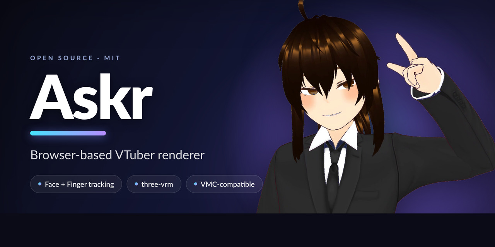
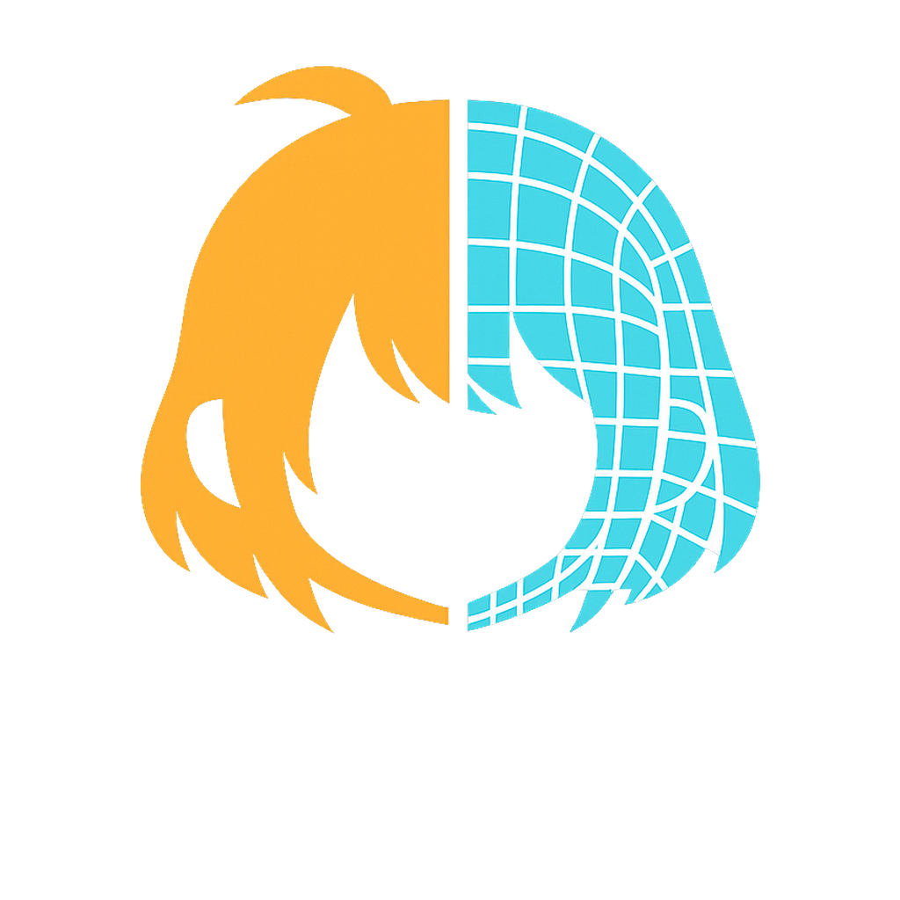

<p align="center">
  
</p>

#  Askr

**ブラウザで動く、いじれる VTuber レンダラ。** 顔（iFacialMocap）と手/腕（Ultraleap Gemini）の
トラッキングを取り込み、[three-vrm](https://github.com/pixiv/three-vrm) で VRM アバターをブラウザ上に
描画する。VMC 互換。出力は OBS のブラウザソース（背景透過）でそのまま取り込める。


> **Askr（アスク）** — 北欧神話で、神々が浜辺の**命の無い流木**に息・動き・姿を与えて作った最初の人間。
> 静的な VRM（＝木）に、トラッキングで**動き**を、レンダリングで**姿**を与えて生かす——このソフトの比喩そのもの。

---

## なぜ作るか

- **フルオープンで全部いじれる軽量レンダラが欲しかった**。ブラウザ完結・生データ直結・スタックを丸ごと自分で握れる——そういう構成が手元に無かった
- **現行 Leap（Gemini / LeapC）を自作パイプラインに取り込む手順自体が希少**。世の情報は廃止済みの旧
  WebSocket API ばかりで皆詰む → [docs/leap-gemini-bringup.md](docs/leap-gemini-bringup.md) に手順をまとめた
- 全ての調整がブラウザ上のパネルで完結し、`config.json` に永続化される。改造前提の素直な構成

## 構成

```
  ┌─────────── 撮影PC ───────────┐        ┌──────────────── レンダーホスト ────────────────┐
  │  iFacialMocap ─┐             │        │  raw_ifm_ws_bridge.py  :49985 → WS :8201        │
  │                ├ ifm_forward.py ──UDP─┼─▶                                              │
  │                │  :49984      │        │  leap_raw_ws_bridge.py :49986 → WS :8202        │
  │  Leap(LeapC) ─ leap_send.py ──UDP──────┼─▶                                              │
  │                              │        │  config_server.py :8199  (index.html + /config) │
  └──────────────────────────────┘        │           │                                    │
                                           │           ▼   ブラウザ (three-vrm renderer)     │
                                           │   http://<host>:8199   WS:8201(顔)/8202(手)受信 │
                                           └───────────────────────┬────────────────────────┘
                                                                    ▼
                                        OBS ブラウザソース (?clean=1, 背景透過α) ──▶ 配信/合成
```

顔と手は独立した経路。撮影PC で VRM の rest pose を持たないため、Leap のリターゲット（関節 → VRM 指/腕
ボーンのローカル回転）は VRM を持つ **renderer(JS) 側**で行う。撮影PC 側は「読んで投げるだけ」。

### ポート

| ポート | 役割 |
|---|---|
| 8199 | renderer 配信 + 設定 API（`config_server.py`。`GET/POST /config`） |
| 8201 | 顔（生 iFM）WebSocket（`raw_ifm_ws_bridge.py`） |
| 8202 | 手/腕（Leap JSON）WebSocket（`leap_raw_ws_bridge.py`） |
| 49984 | 撮影PC の iFacialMocap 受信（`ifm_forward.py`） |
| 49985 | レンダーホストの生 iFM 受信 |
| 49986 | レンダーホストの生 Leap 受信 |
| 8200 / 39540 | （任意）VMC 入力の WebSocket 中継（`vmc_ws_bridge.py`） |
| 8443 | （任意）ブラウザ版トラッカーの HTTPS 配信 **と** WSS 受信（`tracker_server.py`） |
| 8080 | 同・素の HTTP の口（証明書を通さずに疎通だけ確かめる用） |

## セットアップ

### レンダーホスト

```bash
cd renderer
python3 -m venv .venv && . .venv/bin/activate
pip install websockets python-osc          # python-osc は VMC 中継を使う場合のみ
# サンプル VRM 同梱済み（assets/model.vrm・舌焼き込み済みで clone してそのまま舌も動く）
# 自分の VRoid 等に差し替えるなら:
#   cp /path/to/your.vrm assets/model.vrm    # または URL の ?vrm=... で指定
#   自分のモデルに舌を足すなら: python tools/vrm_add_tongue.py in.vrm out.vrm
python config_server.py                      # :8199
python raw_ifm_ws_bridge.py                  # :8201  (顔を使うなら)
python leap_raw_ws_bridge.py                 # :8202  (手を使うなら)
```

ブラウザで `http://<レンダーホスト>:8199` を開く。調整用は素の URL（診断表示あり）。

> 同梱サンプル VRM `renderer/assets/model.vrm` は **© handesen**。再配布可・**要クレジット**・非商用・改変可（コードの MIT とは別ライセンス）。詳細は [`renderer/assets/MODEL_LICENSE.txt`](renderer/assets/MODEL_LICENSE.txt)。

### 撮影PC

Leap は現行 Gemini（LeapC）を隔離 Python 3.12 から叩く。手順は
[docs/leap-gemini-bringup.md](docs/leap-gemini-bringup.md) を参照（ここが要）。

```bash
# 疎通確認
<leap312>\python.exe sender\leap_probe.py
# 送出（--host にレンダーホストを指定）
<leap312>\python.exe sender\leap_send.py --host <レンダーホスト>
# 顔（iFacialMocap を撮影PC:49984 へ送る設定にした上で）
python sender\ifm_forward.py --host <レンダーホスト>
```

### 顔入力その2：スマホのブラウザだけで動く自作トラッカー（iPhone 不要・アプリ不要）

iFacialMocap の代わりに、**手持ちのスマホでページを開くだけ**で顔入力にできる。MediaPipe FaceLandmarker
を端末内で回し、既存の生 iFM パイプ（:49985 → :8201）にそのまま合流するので **renderer 側の設定は不要**。

```bash
cd renderer
tracker/fetch_vendor.sh     # MediaPipe 一式(約26MB)を vendor/ へ。CDN 非依存にするため同梱する
tracker/make_cert.sh        # 自己署名証明書(SAN に LAN IP と、この PC の名前・FQDN・検索ドメイン付きの
                            #   名前を自動で入れる。スマホが `host.lan` の形で引きに行くと
                            #   「自己署名」ではなく「名前が違う」で弾かれるため)
.venv/bin/python tracker_server.py
```

スマホで `https://<レンダーホスト>:8443/` を開く → 初回だけ証明書の警告を「詳細設定 → アクセスする」
→ カメラを許可 → 正面を向いて **[中立に取り直す]**、**[スリープ防止]**。`raw_ifm_ws_bridge.py` が
動いていれば renderer 側はリロード不要。

- **HTTPS が要る理由**：`getUserMedia` はセキュアコンテキスト必須で、localhost 以外は https でないと
  カメラを開けない。
- **HTTPS と WSS を同じ :8443 に同居させている理由**（構成の肝）：自己署名の例外は **host:port 単位**で、
  かつ **WebSocket には警告画面を出せない**（wss:// のハンドシェイクが黙って失敗するだけ）。別ポートに
  分けると WSS 側だけ永久に繋がらない。同一ポートなら、ページを開いて例外を通した時点で WSS も通る。
- **頭ポーズは四元数で直送**する（`=headq#`）。オイラーの軸順・端末の固定向きに悩まされないため。
  受信側は `=headq#` があればそれを使い、無ければ従来のオイラーを使う＝**iFacialMocap 経路は無改造で共存**。
- 自撮りカメラは被写体と向かい合う＝座標系が Y 軸まわりに 180° 回っているので、その補正を
  画面のボタンで切り替えられる（背面カメラを使う場合に切る）。

`http://<レンダーホスト>:8080/` も開けてある。**証明書を一切通らない口**なので、繋がらない時に
「ネットワークが死んでいるのか、TLS で弾かれているのか」を切り分けられる（カメラはセキュア
コンテキスト必須なので、この口のままでは使えない）。

### 舌（tongueOut）

renderer は morph 名に `tongue` を含むモーフを見つけると自動で expression `tongueout` に繋ぐ。
同梱の `renderer/assets/model.vrm` は舌を焼き込み済みなので、そのまま動く。
自分の VRoid 系 VRM は**舌ジオメトリを持たない**ので、付属ツールで焼き込む：

```bash
python tools/vrm_add_tongue.py your_avatar.vrm your_avatar_tongue.vrm
# ※ numpy が要る。元ファイルは書き換えず別ファイルへ出力する
# ※ 既に舌を持つモデル（同梱 model.vrm など）を与えると二重舌防止で中止する
```

舌の値そのものは **iPhone の ARKit（`tongueOut`）が確実**（校正不要）。ブラウザ版トラッカーは
MediaPipe が `tongueOut` を返さない（舌を出した写真で測っても最大 0.0）ため、**口の中の見え方から
自前で推定**している。内唇 20 点のポリゴンの**内側だけ**を切り出して測る（口全体の四角で切ると
唇そのものが赤いので誤検出する）。開いているかの判定は顎の開き（`jawOpen`）ではなく**唇の隙間の
縦横比**——顎を開けずに舌だけ出す「べー」は `jawOpen` がほぼ 0 になるため。

使う前に画面の「**舌 校正**」を**3 回**押す：

1. 口を開けて**歯を見せて**押す
2. 「**あーん**」（舌を下に伏せて大きく開ける）で押す
3. **舌を出して**押す

3 点なのは、舌が「歯の見える口」と「あーん（暗い口）」の**中間**に居るからで、片方としか比べないと
**しきい値の向きすら決まらない**（実測で、比べる相手を変えたら明るさの大小関係がそのまま反転した）。
校正は候補の特徴量の中から「③が①②の両方から最も離れる軸」を自動で選ぶので、**明るい口／暗い口の
どちらの条件でも向きを決め打ちしない**。結果はブラウザに保存される。

**照明や端末の置き方が変わったら押し直す**（選ばれる軸がその場の写り方に依存するため）。

## OBS（ブラウザソースで直接取り込む）

- OBS の**ブラウザソース**に `http://<レンダーホスト>:8199/?clean=1` を指定
  - `?clean=1` で HUD・診断ドット・Leap デバッグ球を**全消し**（＝アバターだけのクリーン映像）
  - 背景透過は renderer が α 対応。OBS ブラウザソースのアルファでそのまま抜ける（クロマキー不要）
- `?cam=N`（N=1〜4）で**起動時のカメラ画角**をスロット N に指定（既定=1）。斜め等の画角を一度パネルで各スロットに保存しておけば、OBS ブラウザソースの URL だけで画角が決まる（パネル操作不要）
  - シーンごとに `?cam=2` / `?cam=3` を指す別ブラウザソースにすれば、**OBS のシーン切替でカメラアングルをカット割り**できる。`?clean=1&cam=2` のように併用可
- これで OBS に取り込めた＝あとは普段どおり配信・録画・合成すればいい（NDI 等の配信手段は各自の環境次第。Askr は OBS のブラウザソースまでで完結）

## 操作

- 全調整は**右上のパネル**（目線・表情・舌・体駆動・Leap の腕/手/指・カメラ・背景）。変更は `config.json` に保存
  - **舌**：tongueOut（iFacialMocap／ブラウザ版トラッカーの自前推定）で駆動。パネルで ON/OFF・強さ・色を調整（OFF で舌メッシュを完全非表示）
- **キー 1–4**：カメラ視点スロットの呼び出し（パネルで保存、起動時はスロット 1 を復元＝URL の `?cam=N` で変更可）
- **Space**：診断表示（HUD/ドット）のトグル

## 既知の限界

- **前腕のねじれ（ソーセージ）**：VRoid 由来の VRM は**ツイスト骨を持たない**ため、前腕の回内/回外が
  単一の骨に集中してメッシュが巻きつく。Askr ではひねりを前腕/手へ配分＋肘下げバイアスで**軽減**して
  いるが、**完全な解消には Blender 等でツイスト骨を追加する**必要がある
- **Leap の肘推定**はデバイス FOV 外だと甘い。単眼 Leap なので可動範囲にも限界がある
- 顔入力は **iFacialMocap（iPhone 等）** か **同梱のブラウザ版トラッカー（上記）** の二択。
  後者は自己署名証明書のため、端末ごとに一度だけ「詳細設定 → アクセスする」が要る

## ライセンス

MIT. See [LICENSE](LICENSE).
